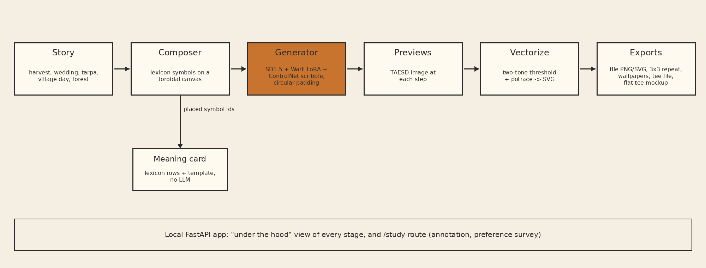

% Chhaap: Layout-first diffusion with symbol survival checks for Warli-inspired product design
% Keshav Shetshringi (PRN 123B1B166); Aadi Kanchankar (PRN 123B1B162, Division C, Batch C1); Swapnil Khillare (PRN 123B1B168); Pratham Kolettiwar (PRN 123B1B169). Project Group ID 62
% Guide: Prof. Pallavi Nikumbh (Dhade). Head of Department: Dr. Anuradha Thakare, Computer Science and Engineering (AI & ML). Pimpri Chinchwad College of Engineering (PCCOE), Pune

# Abstract

Chhaap is a locally hosted generative design tool that turns a short brief into a finished Warli-inspired product design: a wall frame, a saree set, a diary cover, wallpaper, phone wallpapers or a tee. A planner turns the brief into a structured plan, a layout engine places the story's symbols in a structured template with a border, and a designed palette colours each layer. Diffusion then adds only the hand-painted line, and a survival check confirms that every important symbol is still present, repairing any that were lost. The first version, described next, generated single tiles. A user picks a story such as a harvest or a wedding. A composer places symbols from a sourced lexicon on a canvas that wraps at its edges. Stable Diffusion 1.5 with a Warli LoRA and a ControlNet then renders that layout, with circular padding so that the tile repeats without a visible join. The output is traced to a two-tone vector file and exported as a tile, a 3x3 repeat, phone wallpapers and a T-shirt print file. Each design carries a meaning card built from the lexicon rows of the symbols the composer placed, so the card cannot describe a symbol that is absent. We propose ten experiments: six on the tile generator (seam quality, style fidelity, symbol grounding, preference, cost and LoRA settings) and four on the product tool (symbol survival, layout against random scatter, vector-only against diffusion, and planner faithfulness). The system runs on a CPU-only laptop, and every component is free and open source.

# Problem statement

Warli painting is made by hand, on mud walls, in white rice paste on a red ochre ground [14]. Craft clusters therefore design one piece at a time, while digital and all-over printing need a tile that repeats in both directions. In this proposal a tile is called seamless when it repeats without a visible join, and the term is used in that technical sense throughout. Making a tile seamless by hand is slow, and a tile that is merely cropped from a drawing shows a line where its edges meet.

General-purpose image models do not solve this. In this project's first tests, Stable Diffusion 1.5 asked for a Warli repeating pattern drew a framed panel, and repeating that panel gives a grid of frames. Nothing in such a model makes the left edge of an image continue into its right edge. Madar and Fried's Tiled Diffusion makes diffusion outputs join at their edges, from a single self-tiling texture to sets of tiles that connect to each other [12]; it says nothing about what the motifs mean.

The third problem is on the buyer's side. A Warli figure of two joined triangles, a square with a goddess inside it, a ring of dancers around a tarpa: a buyer who sees these on a shirt usually does not know what they stand for [14][16]. A generator that draws such symbols freely can also draw them wrongly, and a caption written afterwards can only guess which ones are present.

# Objectives

1. Build a cleaned Warli image subset with a manifest that records the source and licence status of every file.
2. Build a lexicon of 20 to 25 Warli symbols, each with a drawable geometric rule and a source URL for its meaning.
3. Generate Warli-style tiles whose edges match, and measure that with a seam metric.
4. Make the meaning card true by construction, by deriving it from the symbols the composer placed.
5. Export outputs for screen and print: vector tile, wallpaper, T-shirt file.
6. Show every generative stage in a local app, so a user can see what each one does.
7. Describe a licensing and consent model for deployment, as a proposal.
8. Replace random placement with a layout engine: templates with a hero, supporting scenes, fillers and a border, layered colour from designed palettes, and layouts chosen by the product.
9. Check every placed symbol after diffusion, repair the ones it loses, and split the meaning card into symbols present and symbols lost.
10. Turn a free-text brief into an editable plan that may only use lexicon symbols, with a rules planner that needs no language model.
11. Add a second motif pack, Mandana, with its own sourced lexicon, and label any design that mixes the two as fusion.

# Scope

The project covers Warli painting, with Mandana as a second motif pack, and one tool that runs locally on a CPU-only laptop. It produces product designs (wall frames, a saree set, a diary cover, wallpaper, phone wallpapers and a tee) with mockups, 300 DPI print files and a meaning card. Mandana has a sourced lexicon but no trained style adapter in this project. The training images are used for research only, and the tool has no cart or payment function. The artist-licensed LoRA is a proposal and is not tested in this project. A second style, the Saura painting of Odisha, and artisan verification of the lexicon are left to future work.

# Literature survey

Latent diffusion models run the denoising process in the latent space of a pretrained autoencoder, which cuts the cost of training and sampling compared with pixel-space diffusion [1]. Stable Diffusion 1.5 is a model of this kind and is the base of this project.

LoRA freezes the pretrained weights and trains low-rank update matrices inserted into the layers, which reduces the trainable parameters [2]. It is the practical route to a Warli style on a free Colab T4. DreamBooth fine-tunes a text-to-image model on a few images of a subject and binds them to a rare identifier [4]. Chhaap borrows the identifier idea: training captions start with the trigger word warli_style.

ControlNet adds spatial conditioning to a frozen diffusion model, using inputs such as edges, depth or pose [3]. Chhaap feeds it the composer's black and white layout. LCM-LoRA is a LoRA module distilled from a latent consistency model that can be attached to Stable Diffusion variants without further training and permits few-step sampling [5]. The proposal uses it for 6-step inference on CPU.

For tiling, Bergmann, Jetchev and Vollgraf proposed the periodic spatial GAN, which learns periodic textures and generates outputs of arbitrary size [11]. Madar and Fried's Tiled Diffusion (CVPR 2025) generates tiles that connect, covering self-tiling, many-to-many tile sets and 360-degree images [12]. Chhaap uses the simpler circular padding of every convolution and tests it in an ablation (E1).

Evaluation uses three published tools. FID compares Inception feature statistics of generated and real images [6]. KID is an unbiased alternative introduced with MMD GANs that suits small samples [7], which matters here because N is 16 on CPU. CLIP embeds images and text in one space [8]; Chhaap trains a linear probe on CLIP image embeddings to score Warli-ness. BLIP is used only to caption training images [9].

Potrace converts a bitmap into smooth Bezier outlines [10], which gives the print files unlimited resolution.

# Proposed system

The pipeline has six stages, shown in the figure. A story selects lexicon symbols and layout hints. The composer draws them from their visual rules on a toroidal canvas: a symbol that crosses an edge is drawn again, shifted by the canvas width or height, so it wraps. It returns a control image and the list of placed symbol ids. The generator is SD1.5 with the Warli LoRA and a scribble ControlNet, with every convolution set to circular padding behind a flag. Step previews are decoded with TAESD. The result is thresholded to two tones and traced with potrace. The export stage writes a tile as PNG and SVG, a 3x3 repeat preview, phone wallpapers at 1290x2796 and 1080x2400, a T-shirt print file of 4500x5400 pixels at 300 DPI, and a flat T-shirt mockup. Every export carries the label "AI-generated, Warli-inspired. Not a GI-certified Warli painting."

The meaning card is assembled by a template from the lexicon rows of the placed symbol ids, with their sources listed. No language model writes it.

The second version puts a layout engine and a planner in front of this pipeline. The planner turns a brief into a plan: product, template, density, palette, border and up to four story beats, all checked against the lexicon. The layout engine places the hero, supporting scenes and fillers at product size in one of four templates (a tarpa dance spiral, horizontal registers, a central medallion, or an all-over field of small motifs on a half-drop), and records each element's colour layer. Diffusion runs on the monochrome drawing at up to 768 pixels. A survival check then compares every placed symbol with the output inside its box; a lost hero or supporting symbol triggers a rerun with a stronger ControlNet, and then the clean vector symbol is put back. The repaired drawing is traced, recoloured layer by layer from one of eight palettes, given a mud-wall texture, and placed on a product mockup.

The local FastAPI app has an "under the hood" view that shows the prompt and its CLIP tokens, the control image, a filmstrip of step previews, the decoded result, the vectorized output and a timing breakdown, each with a plain-language paragraph. A hidden /study route holds an annotation page and a blind preference survey. Results are stored in SQLite. Each generation writes its prompt, seed, steps, guidance scale, LoRA scale, ControlNet scale, padding flag and timings to a file, so every figure can be traced to its settings.

# Methodology

Data preparation removes near-duplicate Warli images by perceptual hash (distance 6 or less), drops images under 512 pixels on the short side, filters product photos, watermarks and text-heavy images with a CLIP zero-shot check followed by a manual review of one contact sheet, and center-crops to 512x512. The images are split 80/20 into training and held-out sets. The held-out set is never trained on. Training images are captioned with BLIP and each caption begins with warli_style.

The lexicon is built by reading the sources in [14], [15] and [16] and further sources found during the work. A row with no source URL is deleted. Each row has a geometric recipe the composer can draw. No row is verified by an artisan yet, and the meaning card says so.

The LoRA is trained on the Stable Diffusion 1.5 base with the diffusers text-to-image LoRA script: rank 16, 512 pixels, 1500 steps, learning rate 1e-4, with checkpoints at 500, 1000 and 1500 steps. It was trained on 45 Warli images on a free Colab GPU in about 10 minutes, since the laptop has no NVIDIA GPU. Inference on the laptop uses LCM-LoRA at 6 steps.

Seed values are fixed and logged, and the same prompts and seeds are used in every experimental condition.

# Dataset

The style images come from the Kaggle "Indian paintings dataset" by ajg117 [13], which has 8 classes: gond, kalighat, kangra, kerala mural, madhubani, mandana, pichwai and warli. All 8 classes are used for the style classifier. Only the Warli class is cleaned and used for LoRA training. The licence of the dataset is unclear and the images were scraped, so the proposal treats it as research use only. A manifest records every image with the columns file, class, source_url, license, w, h, kept, drop_reason and split. The Warli class has 97 readable images. After cleaning, 56 remain: 45 for training and 11 held out.

# Evaluation plan

The number of samples per condition (N) is 16 on this CPU, and 50 on a GPU. Prompts and seeds are the same in every condition. Results are reported in the accompanying paper; this section gives the plan.

The seam metric is the Seam Discontinuity Ratio (SDR). For a tile T of size H by W, build a 2x2 mosaic and compute the Sobel gradient magnitude of its grayscale version. SDR is the mean gradient in 4-pixel bands centred on the seam lines (x = W and y = H) divided by the mean gradient in 4-pixel bands at 8 random interior lines. A value near 1 means the seam is as smooth as the interior. The wrap error is the mean of |T[:,0] - T[:,-1]| and |T[0,:] - T[-1,:]|, divided by the mean difference between adjacent interior columns and rows. A unit test will check that a known seamless tile scores about 1 and a shifted, broken tile scores well above 1.

| Experiment | Conditions | Metric |
|:--|:--|:--|
| E1 tiling ablation | (a) base, text only; (b) base with circular padding; (c) LoRA; (d) LoRA with circular padding; (e) full pipeline: composer, ControlNet, LoRA, circular padding | SDR and wrap error, mean and standard deviation, with a Wilcoxon test of (e) against (a) |
| E2 style fidelity | (a), (c) and (e) against the held-out Warli images | KID (torchmetrics, subset size no larger than N) and the Warli probability of a CLIP linear probe, a logistic regression on openai/clip-vit-base-patch32 embeddings of all 8 classes, with its own test accuracy reported |
| E3 symbol grounding | (a) with symbols named in the prompt against (e) with the same symbols composed | Fraction of requested symbols present, from human annotation in the app |
| E4 preference pilot | (a) against (e), and (e) with against without the meaning card | Win rate and n |
| E5 cost | Each condition on this hardware | Seconds per image and peak memory |
| E6 LoRA steps | Checkpoints at 500, 1000 and 1500 with LoRA strength 0.4, 0.8 and 1.2 | Contact sheet, plus the E2 metrics if time allows |
| E7 symbol survival | The full product pipeline across all four templates | Survival rate per symbol, and survival against symbol complexity |
| E8 layout against scatter | Random scatter against each template, same symbols and seeds | Evenness of ink over a 4 by 4 grid, overlapping symbols, blind preference |
| E9 what diffusion adds | Vector only, stylized, stylized with repair | Survival rate, seconds per design, blind preference |
| E10 planner faithfulness | 20 fixed briefs through each available planner | Valid plans, share of the brief's stated constraints the plan meets, time |

If nobody annotates, E3 is reported as not run. E4 with fewer than 10 responses is reported as a pilot with its exact n, and with none as not run.

# Hardware and software

The project runs on a laptop with an Intel Core Ultra 7 155H CPU and 15 GB of RAM, and no NVIDIA GPU. Inference uses SD1.5 with LCM-LoRA at 6 steps on the CPU. LoRA training ran on a free Google Colab GPU. The software is Python, PyTorch, diffusers, FastAPI, SQLite and potrace, all free and open source. No paid service is used, and the tool has no cart or payment function; product mockups are images only.

# Ethics and IP

Warli painting has a Geographical Indication (GI) tag, granted in 2014 to an application filed by the Adivasi Yuva Seva Sangh [18], [20]. A generated tile is not a GI-certified Warli painting, and every export says so.

GI protection can itself be contested. An article on Gond art reports that Gond art received a GI tag in April 2023, awarded to two organisations in Dindori district, and that Bhopal artists and the family of Jangarh Singh Shyam objected that their group was not named among the applicants. It quotes his son, Mayank Kumar Shyam: "we want the name of Jangar Singh to be among the names of GI applicants." It also quotes Dindori District Collector Vikas Misra: "the GI tag is for all Gond artists" [17]. The lesson for Chhaap is that deciding who speaks for a tradition is not a technical question, and the tool should not make that decision silently.

The training images were scraped and their licence is unclear [13]. They are used for research only. The app and any report state this, and no generated image is offered as a commercial product.

As a deployment model, the proposal is an artist-licensed LoRA: Warli artists who consent contribute work, a LoRA is trained only on that work, and revenue from its use is paid to them as royalties. This is a proposal. It has not been tested, and no artists have been approached. The lexicon meanings come from published sources and are not yet verified by a Warli artist, which the meaning card states.

# Mapping to course units

The unit titles are not available to the author at the time of writing, so the table gives the unit codes and the project component that is proposed for each. The assignment is provisional until the titles are checked.

| Unit code | Project component |
|:--|:--|
| V-I | Data collection, cleaning and manifest |
| V-III | LoRA training, the generation pipeline and the layout engine |
| V-VI | The FastAPI app and the under the hood view |
| VI-I | Evaluation experiments E1 to E10 |
| VI-IV | Ethics, licensing and documentation |

# Timeline

The plan has eight weeks.

| Weeks | Work |
|:--|:--|
| 1 | Download and clean the Warli images, write the manifest, caption images |
| 2 | Build the lexicon with sources, write the composer |
| 3 | Train the LoRA on Colab, build the generator with circular padding |
| 4 | Vectorization, exports, meaning card |
| 5 to 6 | The app: compose, generate, under the hood, repeat and export views |
| 7 | Experiments E1, E2, E5, E6; annotation and survey for E3 and E4 |
| 8 | Analysis, report |
| 9 to 10 | Version two: planner, layout engine, palettes, products and mockups, survival check, Mandana pack; experiments E7 to E10 |

# Expected outcomes

The project is expected to deliver a cleaned Warli subset with its manifest, a lexicon of 20 to 25 sourced symbols, a working local tool that runs on a CPU-only laptop, and the export files listed above. The experiments are expected to show whether circular padding lowers SDR against the base model, and whether composing symbols raises the fraction of requested symbols present compared with naming them in a prompt. Either result is reported as measured. For the product tool, the experiments are expected to show which symbols diffusion loses and whether repair recovers them, whether structured templates spread a design more evenly than random scatter, and what diffusion costs against vector-only rendering. The preference studies are pilots and will not support a general claim.

# Future work

A second style is the Saura painting of Odisha, which received a GI tag in 2024 according to a PTI report [19]. A pilot with two or three Warli artists would test the licensing model and check the lexicon. Artisan verification of every lexicon row would let the meaning card drop its disclaimer.

# References

[1] R. Rombach, A. Blattmann, D. Lorenz, P. Esser and B. Ommer, "High-resolution image synthesis with latent diffusion models," in Proc. IEEE/CVF CVPR, 2022. https://openaccess.thecvf.com/content/CVPR2022/html/Rombach_High-Resolution_Image_Synthesis_With_Latent_Diffusion_Models_CVPR_2022_paper

[2] E. J. Hu et al., "LoRA: Low-rank adaptation of large language models," in Proc. ICLR, 2022. https://arxiv.org/abs/2106.09685

[3] L. Zhang, A. Rao and M. Agrawala, "Adding conditional control to text-to-image diffusion models," in Proc. IEEE/CVF ICCV, 2023, pp. 3836-3847. https://arxiv.org/abs/2302.05543

[4] N. Ruiz, Y. Li, V. Jampani, Y. Pritch, M. Rubinstein and K. Aberman, "DreamBooth: Fine tuning text-to-image diffusion models for subject-driven generation," in Proc. IEEE/CVF CVPR, 2023, pp. 22500-22510. https://openaccess.thecvf.com/content/CVPR2023/html/Ruiz_DreamBooth_Fine_Tuning_Text-to-Image_Diffusion_Models_for_Subject-Driven_Generation_CVPR_2023_paper.html

[5] S. Luo et al., "LCM-LoRA: A universal Stable-Diffusion acceleration module," arXiv:2311.05556, 2023. https://arxiv.org/abs/2311.05556

[6] M. Heusel, H. Ramsauer, T. Unterthiner, B. Nessler and S. Hochreiter, "GANs trained by a two time-scale update rule converge to a local Nash equilibrium," in Proc. NeurIPS, 2017. https://arxiv.org/abs/1706.08500

[7] M. Binkowski, D. J. Sutherland, M. Arbel and A. Gretton, "Demystifying MMD GANs," in Proc. ICLR, 2018. https://arxiv.org/abs/1801.01401

[8] A. Radford et al., "Learning transferable visual models from natural language supervision," in Proc. ICML, PMLR 139, 2021, pp. 8748-8763. https://proceedings.mlr.press/v139/radford21a.html

[9] J. Li, D. Li, C. Xiong and S. Hoi, "BLIP: Bootstrapping language-image pre-training for unified vision-language understanding and generation," in Proc. ICML, PMLR 162, 2022, pp. 12888-12900. https://proceedings.mlr.press/v162/li22n.html

[10] P. Selinger, "Potrace: a polygon-based tracing algorithm," 2003. https://potrace.sourceforge.net/potrace.pdf

[11] U. Bergmann, N. Jetchev and R. Vollgraf, "Learning texture manifolds with the periodic spatial GAN," in Proc. ICML, 2017. https://arxiv.org/abs/1705.06566

[12] O. Madar and O. Fried, "Tiled Diffusion," in Proc. IEEE/CVF CVPR, 2025. arXiv:2412.15185. https://arxiv.org/abs/2412.15185

[13] ajg117, "Indian paintings dataset," Kaggle. https://www.kaggle.com/datasets/ajg117/indian-paintings-dataset

[14] B. Baral and S. B., "Warli painting - Nagpur, Maharashtra: Introduction," D'Source, IDC School of Design, IIT Bombay (authors at NID Bengaluru). https://www.dsource.in/resource/warli-painting-nagpur-maharashtra/introduction

[15] "Warli painting," Wikipedia. https://en.wikipedia.org/wiki/Warli_painting

[16] Organiser article on the Warli tribe and its folk tradition, 14 November 2025. [organiser.org/2025/11/14/325690](https://organiser.org/2025/11/14/325690/bharat/the-enduring-legacy-of-the-warli-tribe-guardians-of-maharashtras-living-folk-tradition/)

[17] P. David, "Gond art: stories of the forest and the land," People's Archive of Rural India, 7 April 2024. https://ruralindiaonline.org/bn/articles/gond-art-stories-of-the-forest-and-the-land

[18] "Understanding Warli culture," Sabrang India. https://sabrangindia.in/understanding-warli-culture/

[19] "Seven Odisha products get GI tag," PTI report, The Week, 4 January 2024. https://www.theweek.in/wire-updates/national/2024/01/04/ces2-od-gi-tag.amp.html

[20] "How Adivasi women reclaim Warli art for international recognition with murals, GI tags," The Better India, 11 September 2022. https://thebetterindia.com/296974/how-adivasi-women-reclaim-warli-art-for-international-recognition-with-murals-gi-tags
